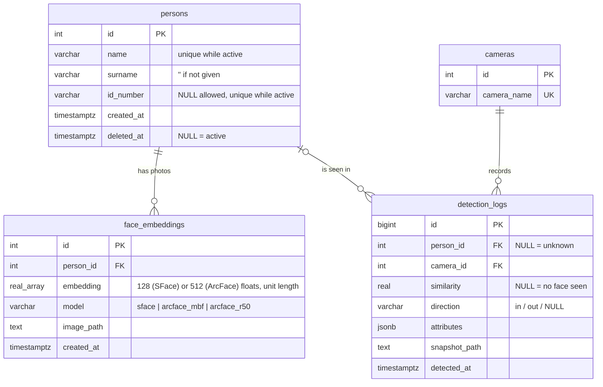

# Database Design

_PostgreSQL 16 · SQLAlchemy 2.0 + psycopg 3 · updated 2026-10-24_

The database is optional. It is used when the environment variable `DATABASE_URL` is set
(see "Database" in `how _to_use.txt`). Without it the program keeps using
`output/people.json` and the CSV files, exactly as before.

The database has four tables:

- `persons` (registered people)
- `face_embeddings` (one face vector per enrollment photo and face model: SFace or ArcFace)
- `cameras`
- `detection_logs` (the timestamp log: sightings and in/out crossings)

A person has many photos and many log rows. A camera has many log rows. A log row has exactly one camera and zero or one person, where none means an unknown face.

Code: `new/person_detection/storage/database.py` (tables, gallery, log writer, queries) and
`new/register.py` (command line). Tests: `new/tests/test_database.py`, `web/cameras/tests_db.py`.

## 0. Changes from the 2026-10-08 design

| Change | Why |
|---|---|
| `detection_logs.direction` (`'in'` / `'out'` / NULL) | The project counts people going in and out. A sighting row has NULL; each crossing of the counting zones (`counting/direction.py`) is its own row. |
| `detection_logs.attributes` JSONB | Keeps what the CSV had: shirt/pants colour, detection confidence, multi-camera global id (`G7`), YOLO track id, and `name_source`. |
| `detection_logs.similarity` may be NULL | A person with their back to the camera has no face score. NULL = no face seen, or the name came from another camera (`name_source = other_camera`). |
| `persons.surname` defaults to `''`, `persons.id_number` may be NULL | The web page and `enroll.py` ask only for a name; surname and ID are optional fields. The partial unique index still blocks two active people with the same ID. |
| Unique active `persons.name` | The cameras match and display people by name, so two active people cannot share one. |
| Soft delete also deletes `face_embeddings` rows | Face vectors are biometric data (PDPA section 26); after a person is removed there is no reason to keep them. The `persons` row stays so old logs still point to it. |
| Sessions use time zone `Asia/Bangkok` | `date_trunc('day', now())` and the history page then mean a Thai calendar day (Docker's default is UTC, so "today" would start at 07:00). |
| `CHECK (cardinality(embedding) IN (128, 512))` + column `model` | Every vector says which face model made it (SFace 128 numbers, ArcFace 512). Vectors of two models can't be compared, so each model reads only its own rows. |

## 1. Entity–relationship diagram



In Mermaid, `||` is exactly one, `|o` is zero or one, and `o{` is zero or many.

## 2. Relationships

| From → To | Cardinality | FK and delete rule |
|---|---|---|
| `persons` → `face_embeddings` | 1 to 0..* | `face_embeddings.person_id` NOT NULL, `ON DELETE CASCADE` |
| `persons` → `detection_logs` | 0..1 to 0..* | `detection_logs.person_id` NULL allowed, no cascade |
| `cameras` → `detection_logs` | 1 to 0..* | `detection_logs.camera_id` NOT NULL |

There is no many-to-many relationship.

## 3. Tables

### `persons`

| Column | Type | Null | Constraint / default | Description |
|---|---|---|---|---|
| `id` | `SERIAL` | no | PK | |
| `name` | `VARCHAR(100)` | no | partial unique `WHERE deleted_at IS NULL` | Name the cameras show (e.g. `Arm`) |
| `surname` | `VARCHAR(100)` | no | `''` | Last name (optional) |
| `id_number` | `VARCHAR(20)` | yes | partial unique `WHERE deleted_at IS NULL AND id_number IS NOT NULL` | Student / staff ID (optional) |
| `created_at` | `TIMESTAMPTZ` | no | `now()` | |
| `deleted_at` | `TIMESTAMPTZ` | yes | | Soft delete; NULL = active |

### `face_embeddings`

| Column | Type | Null | Constraint / default | Description |
|---|---|---|---|---|
| `id` | `SERIAL` | no | PK | |
| `person_id` | `INTEGER` | no | FK → `persons.id` ON DELETE CASCADE, indexed | |
| `embedding` | `REAL[]` | no | `cardinality IN (128, 512)` | Face vector of one photo, unit length |
| `model` | `VARCHAR(32)` | no | default `'sface'` | Face model that made the vector (`FACE_RECOGNIZER`, see PERFORMANCE.md) |
| `image_path` | `TEXT` | yes | | The photo in `models/photos/<name>/` |
| `created_at` | `TIMESTAMPTZ` | no | `now()` | |

Matching uses the **mean** of a person's photos (normalised), the same as `people.json` did, so
recognition results do not change when switching to the database. Only the rows of the face model
in use are read. When the model is changed on the settings page, the app makes the new model's rows
from the photos in `models/photos/<name>/`; `persons` (names, IDs) and old `detection_logs` stay as they are.
A database made by an older version gets the `model` column automatically on start-up
(`Database.upgrade()`, existing rows become `'sface'`).

### `cameras`

| Column | Type | Null | Constraint | Description |
|---|---|---|---|---|
| `id` | `SERIAL` | no | PK | |
| `camera_name` | `VARCHAR(100)` | no | UNIQUE | `cam1` (connect.py), the camera's name in the app, `this-pc`, … Inserted automatically the first time it logs. |

### `detection_logs`

| Column | Type | Null | Constraint | Description |
|---|---|---|---|---|
| `id` | `BIGSERIAL` | no | PK | |
| `person_id` | `INTEGER` | yes | FK → `persons.id` | NULL = unknown |
| `camera_id` | `INTEGER` | no | FK → `cameras.id` | |
| `similarity` | `REAL` | yes | | Best cosine similarity of this camera's face match |
| `direction` | `VARCHAR(3)` | yes | `CHECK (direction IN ('in','out'))` | NULL = sighting; in/out = crossing |
| `attributes` | `JSONB` | yes | | `shirt_color`, `pants_color`, `confidence`, `global_id`, `track_id`, `name_source` (`face` / `other_camera` / `none` / `csv_import`) |
| `snapshot_path` | `TEXT` | yes | | Photo in `output/cropped_persons/` when SAVE_CROPS is on |
| `detected_at` | `TIMESTAMPTZ` | no | | When the row was made (stored in UTC, shown in Thai time) |

### Indexes

| Index | On | Speeds up |
|---|---|---|
| `uq_persons_name_active` (unique, partial) | `persons(name) WHERE deleted_at IS NULL` | name lookup; one active person per name |
| `uq_persons_id_number_active` (unique, partial) | `persons(id_number) WHERE deleted_at IS NULL AND id_number IS NOT NULL` | blocks duplicate active IDs |
| `ix_face_embeddings_person_id` | `face_embeddings(person_id)` | gallery JOIN |
| `ix_face_embeddings_model_person` | `face_embeddings(model, person_id)` | gallery of one face model |
| `cameras_camera_name_key` (unique) | `cameras(camera_name)` | camera lookup |
| `ix_detection_logs_detected_at` | `detection_logs(detected_at)` | "today", time ranges |
| `ix_detection_logs_person_time` | `detection_logs(person_id, detected_at)` | one person's history |
| `ix_detection_logs_camera_time` | `detection_logs(camera_id, detected_at)` | one camera's history |

## 4. Design decisions

- **The tracker ID is not a column.** YOLO's track ID restarts at 1 every run, so it identifies nothing across runs. It is kept in `attributes` only to tell rows of one run apart. In memory it still makes sure a person is logged **once per visit**, not once per frame — that is what stops duplicate rows, not a database constraint.
- **Cameras are a separate table**, so a camera name is stored once and filtering by camera uses an integer index.
- **Delete is a soft delete** for the person and a hard delete for their face vectors. Old logs keep pointing at the right person, and names come from a JOIN.
- **There is no `is_known` column.** It equals `person_id IS NOT NULL`.
- **`REAL[]` holds the embedding.** No extension needed; matching is done in memory with NumPy, which is faster than a database search at this size. With hundreds of thousands of faces, pgvector with an HNSW index would be the next step.
- **Logs are written in batches from a background thread** (`DetectionLogWriter`): up to 200 rows per INSERT, at least once a second. If the database is unreachable the rows wait in memory (up to 20 000) and are written when it is back; the video never waits for the database.
- **The face gallery is cached** in each program and re-read within 3 seconds when another program (the web page, `enroll.py`) changes it.

## 5. Command line (`new/register.py`)

```text
python register.py init                 create the tables, set the database time zone
python register.py status               connection, row counts, newest log row
python register.py list                 registered people
python register.py delete NAME          soft delete
python register.py import-people        output/people.json -> persons + face_embeddings
python register.py import-csv           output/person_log_*.csv -> detection_logs (safe to repeat)
python register.py purge --days 90      delete log rows and snapshots older than 90 days
```

People are added with `enroll.py NAME FOLDER [--surname X --id N]` or on the web page
(คนที่ลงทะเบียน), which ask for surname and ID when the database is on.

## 6. Example queries

```sql
-- Today's rows with names and camera, newest first
SELECT l.detected_at, coalesce(p.name || ' ' || p.surname, 'Unknown') AS who,
       p.id_number, c.camera_name, l.direction, l.similarity
FROM detection_logs l
JOIN cameras c ON c.id = l.camera_id
LEFT JOIN persons p ON p.id = l.person_id
WHERE l.detected_at >= date_trunc('day', now())
ORDER BY l.detected_at DESC;

-- In and out per hour today, and how many are inside now
SELECT date_trunc('hour', detected_at) AS hour,
       count(*) FILTER (WHERE direction = 'in')  AS went_in,
       count(*) FILTER (WHERE direction = 'out') AS went_out
FROM detection_logs
WHERE direction IS NOT NULL AND detected_at >= date_trunc('day', now())
GROUP BY hour ORDER BY hour;

SELECT count(*) FILTER (WHERE direction = 'in') - count(*) FILTER (WHERE direction = 'out') AS inside_now
FROM detection_logs WHERE detected_at >= date_trunc('day', now());

-- First and last time each active person was seen today
SELECT p.name, p.surname, min(l.detected_at) AS first_seen, max(l.detected_at) AS last_seen, count(*)
FROM persons p JOIN detection_logs l ON l.person_id = p.id
WHERE p.deleted_at IS NULL AND l.detected_at >= date_trunc('day', now())
GROUP BY p.id ORDER BY first_seen;

-- Unknown people in the last hour, per camera, with their clothes
SELECT c.camera_name, l.detected_at, l.attributes->>'shirt_color' AS shirt, l.snapshot_path
FROM detection_logs l JOIN cameras c ON c.id = l.camera_id
WHERE l.person_id IS NULL AND l.detected_at > now() - interval '1 hour';
```

To open a SQL shell in the Docker container:

```bash
docker exec -it person_detection_db psql -U postgres -d person_detection
```

## 7. Verified (2026-10-24, PostgreSQL 16, SQLAlchemy 2.0.44, psycopg 3.2.12)

`new/tests/test_database.py` (13 tests) and `web/cameras/tests_db.py` (7 tests) pass against a
real PostgreSQL 16, together with all earlier tests (62 core, 42 web). They check:

- the database gallery gives the same vector as `people.json` for the same photos;
- re-enrolling replaces a person's photos (no duplicates); a duplicate ID is refused and nothing is half-saved;
- soft delete hides the person, deletes their vectors, keeps their log rows; the same name/ID can register again;
- a face seen by the browser camera on the web page is logged with the person's id and similarity above 0.363;
- a person with no face is logged with `person_id` and `similarity` NULL; a crossing writes a second row with `direction = 'in'`;
- the writer keeps rows while the database is down and writes them when it returns;
- a row at 23:30 Thai time belongs to that Thai day, not the next one;
- `import-csv` run twice does not double the rows; `purge` removes old rows and their snapshot files.
